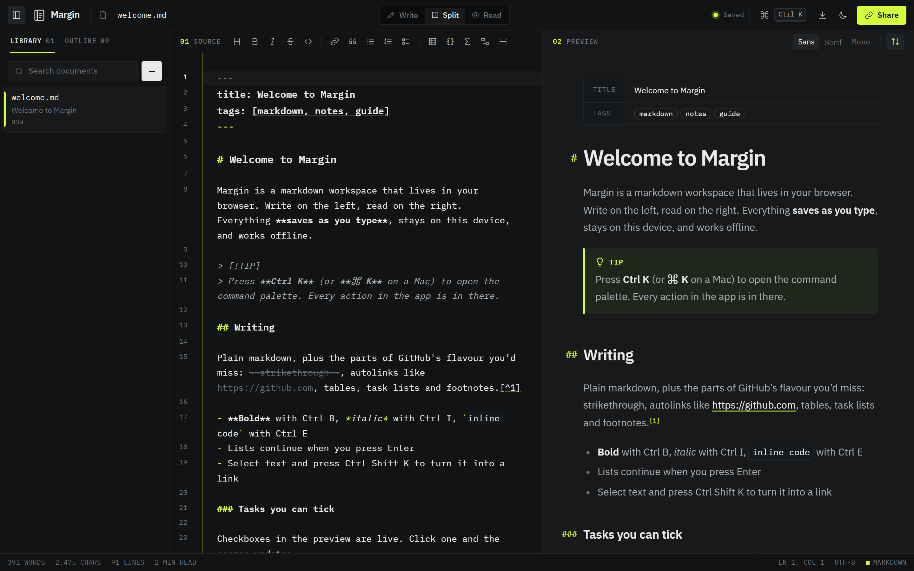
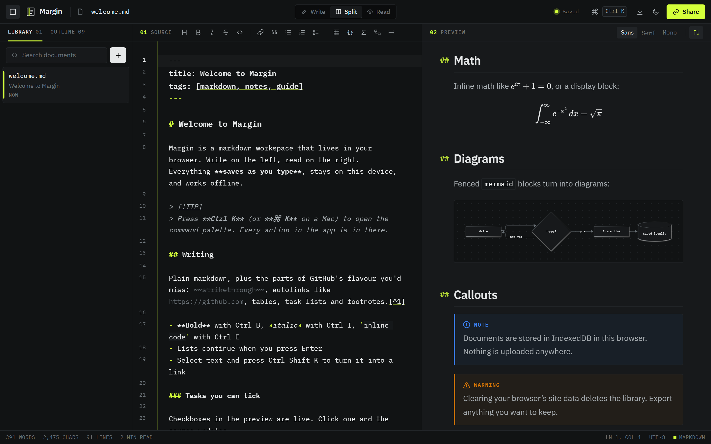
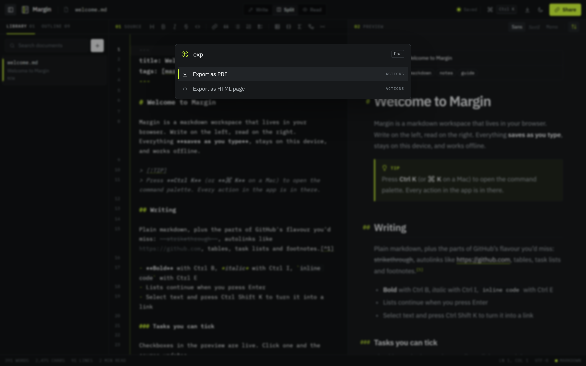
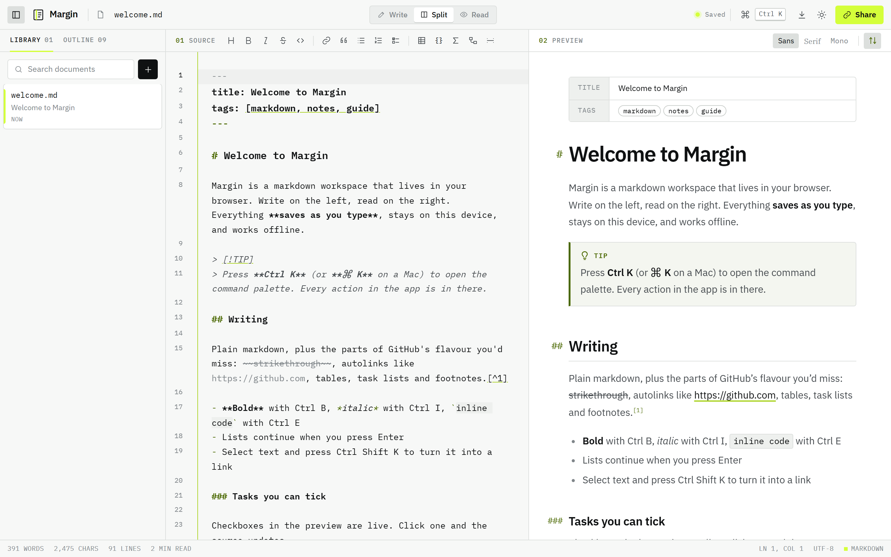
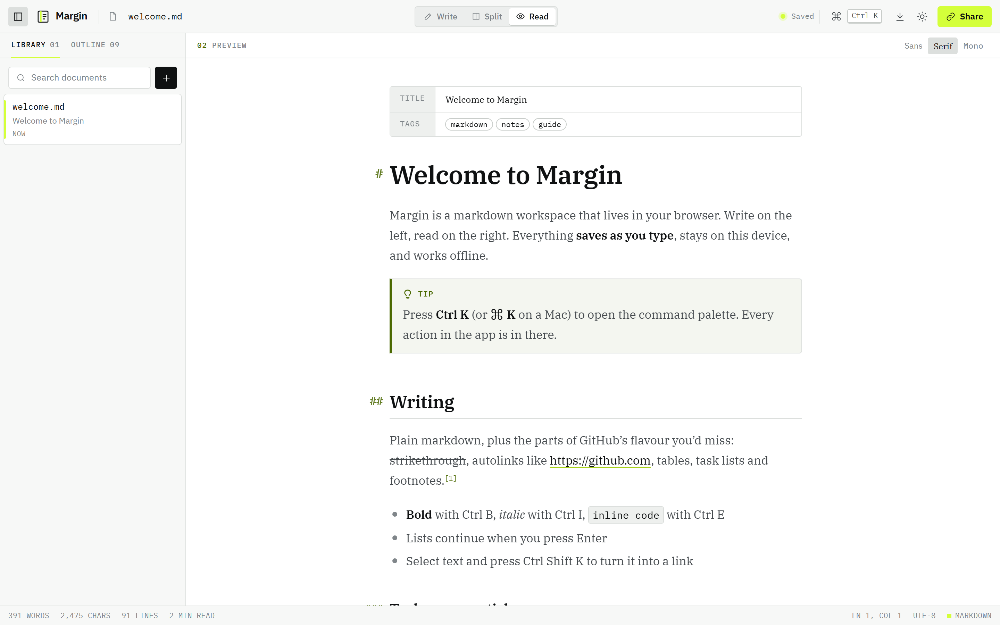
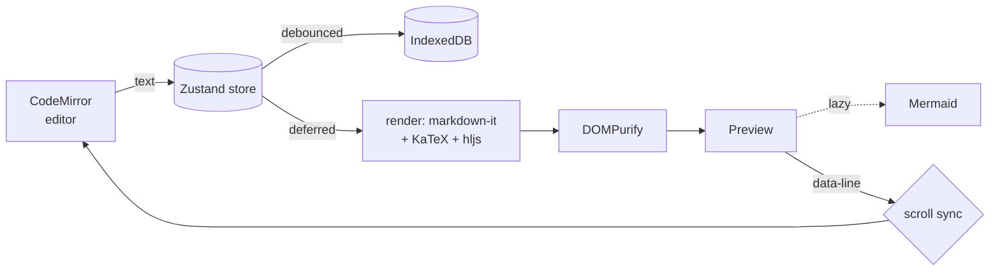

<div align="center">

# Margin

**A markdown workspace that runs entirely in your browser. Write on the left and read on the right. Math, diagrams and code all render as you type. Documents save themselves locally, and a share link carries the whole document inside it.**

Built with **React 19**, **TypeScript**, **CodeMirror 6**, **markdown-it** and **Tailwind 4**.

[](https://github.com/AutumnTrace/margin/actions/workflows/ci.yml)
[](https://github.com/AutumnTrace/margin/actions/workflows/deploy.yml)


[](LICENSE)

### [▶ Open Margin](https://autumntrace.github.io/margin/)

<sub>No sign-up and no server. Your documents stay in your browser.</sub>

</div>

<p align="center">
  
</p>

---

## Highlights

| | |
|---|---|
| ✍️ **A real editor** | CodeMirror 6 with markdown highlighting, syntax colours inside fenced code (lazy-loaded per language), search and replace, multi-cursor, bracket matching, and list continuation on Enter. |
| ⌨️ **Formatting without the mouse** | `Ctrl B / I / E`, `Ctrl Shift K` for links, `Ctrl Shift 7 / 8 / 9` for lists and tasks. Toolbar buttons wrap or unwrap a selection, and switch block types instead of stacking them (`- item` becomes `1. item`). |
| 🧮 **More than markdown** | GitHub-flavoured tables, task lists, footnotes and `> [!NOTE]` callouts, **KaTeX** math (`$…$`, `$$…$$`, ` ```math `), **Mermaid** diagrams, and YAML front matter shown as a properties sheet. |
| ☑️ **A live preview** | Ticking a checkbox in the preview edits the source. Code blocks have a copy button. Heading links and footnotes scroll inside the preview. |
| ↕️ **Scroll sync** | Every rendered block knows its source line. Whichever pane you're scrolling leads, and positions between blocks are interpolated, so long documents stay aligned. |
| 💾 **Saves as you type** | Documents live in IndexedDB with a debounced autosave and a status indicator. Pending writes flush when the tab is hidden or closed. |
| 📂 **Real files too** | Open or drop `.md` files anywhere on the window. In Chrome and Edge, `Ctrl S` writes back to the same file on disk through the File System Access API. Elsewhere it downloads a copy. |
| 🔗 **Share links with no server** | The document is compressed (lz-string) into the URL fragment, which never reaches a server. Opening the link adds the document to the recipient's library. |
| 📤 **Export** | Markdown, a standalone HTML page with the preview styles inlined (diagrams already drawn), or PDF through a print stylesheet. |
| 🎛️ **Command palette** | `Ctrl K` fuzzy-searches every action, every document and every heading in the current one. |
| 🌗 **Made to be looked at** | Graphite or cool-paper themes, IBM Plex Sans / Serif / Mono, hairline rules, and one lime accent for the margin rule, the caret and whatever is active. You can choose a sans, serif or mono reading font. There's also a focus mode, and a mobile layout with Write/Read tabs. |
| 🛡️ **Safe to paste into** | Raw HTML is allowed, but it is sanitised with DOMPurify: no scripts, event handlers, `javascript:` links, `<style>`, `<iframe>` or forms. Mermaid runs in `strict` security mode. A shared link can't run code in your browser. |

<table>
  <tr>
    <td width="50%"></td>
    <td width="50%"></td>
  </tr>
  <tr>
    <td align="center"><sub>Math, diagrams and callouts</sub></td>
    <td align="center"><sub>The command palette (<code>Ctrl K</code>)</sub></td>
  </tr>
  <tr>
    <td width="50%"></td>
    <td width="50%"></td>
  </tr>
  <tr>
    <td align="center"><sub>Light theme</sub></td>
    <td align="center"><sub>Read mode, serif</sub></td>
  </tr>
</table>

## Keyboard

| Shortcut | Action |
|---|---|
| `Ctrl K` | Command palette |
| `Ctrl S` | Save to disk (writes back to an opened file) |
| `Ctrl O` | Open markdown files |
| `Alt N` | New document |
| `Alt 1` / `Alt 2` / `Alt 3` | Write / Split / Read |
| `Ctrl \` | Toggle the library |
| `Ctrl .` | Focus mode (`Esc` to leave) |
| `Ctrl B` / `Ctrl I` / `Ctrl E` | Bold / italic / inline code |
| `Ctrl Shift K` | Link |
| `Ctrl Shift 7` / `8` / `9` | Numbered / bulleted / task list |
| `Ctrl Alt 1` / `2` / `3` | Heading 1 / 2 / 3 |
| `Ctrl F` | Find and replace |
| `?` | Keyboard shortcuts sheet |

On a Mac, `Ctrl` is `⌘`.

## How it works



- **`src/lib/markdown.ts`**: one markdown-it pipeline with footnotes, task lists, GitHub alerts and KaTeX. A core rule stamps `data-line` on every block, and another assigns unique heading ids for the outline. Front matter is split off, parsed with `yaml`, and its lines are added back to the offsets. The output always goes through `sanitize()`.
- **`src/store.ts`**: the document library and UI preferences (Zustand). Each document saves on its own debounce timer, and preferences go to `localStorage`.
- **`src/editor/`**: the CodeMirror setup, its theme (built from the same CSS tokens as the app) and the formatting commands, which are unit-tested against a real `EditorView`.
- **`src/components/useScrollSync.ts`**: maps editor height ↔ source line ↔ preview offset through the `data-line` markers. It is re-measured when the preview resizes (images, diagrams, fonts).
- **`src/lib/mermaid.ts`**: Mermaid is about 1 MB, so it is imported the first time a document contains a diagram. Its SVGs are cached by theme and source, so typing elsewhere doesn't redraw them.

## Run it locally

```bash
npm install
npm run dev          # http://localhost:5173
```

| Script | |
|---|---|
| `npm run build` | Type-check and build to `dist/` |
| `npm test` | Unit tests (Vitest + jsdom + fake-indexeddb) |
| `npm run test:e2e` | Playwright against the production build: desktop Chrome and a Pixel 7 |
| `npm run lint` | oxlint (React, a11y, TypeScript rules) |
| `node scripts/screenshots.mjs` | Regenerate the README screenshots from a running preview |

## Tests

- **Unit (31)**: rendering (GFM, front matter offsets, math, diagrams, alerts, footnotes, heading ids, and **XSS sanitisation**), share-link round trips, word counts and snippets, fuzzy matching, every editor command, and the store's create/rename/duplicate/delete/restore with real IndexedDB writes.
- **End-to-end (10)**: the welcome guide renders, typing persists across a reload, shortcuts and toolbar, live checkboxes, the command palette, share links opened in a second tab, rename/download/delete with undo, script injection attempts, view modes and focus mode, and a mobile run.

## License

MIT © Mina Rotari
